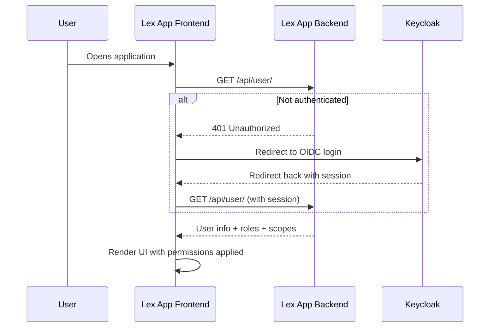

Lex App provides fine-grained access control through permission methods defined directly on your models. You can control which fields a user can view, edit, or export, which records they can see, and which actions they can perform — all integrated with [Keycloak](https://www.keycloak.org/documentation).

## The UserContext Object

All permission methods receive a `UserContext` dataclass with clean user information:

```python
@dataclass(frozen=True)
class UserContext:
    user: Any              # Django User object
    email: str             # User's email address
    is_authenticated: bool # Is user logged in?
    is_superuser: bool     # Is user a superuser?
    groups: Set[str]       # Group names, e.g. {'admin', 'finance'}
    keycloak_scopes: Set[str]  # Keycloak permission scopes
    request: Any           # the request it was made from (3.0), e.g. its request.lex_scope
```

## Basic Example

```python title="MyModel.py"
from lex.core.models.LexModel import LexModel, UserContext, PermissionResult
from django.db import models


class MyModel(LexModel):
    name = models.CharField(max_length=100)
    sensitive_field = models.CharField(max_length=100)
    owner_email = models.EmailField()

    def permission_read(self, user_context: UserContext) -> PermissionResult:
        if user_context.is_superuser or 'admin' in user_context.groups:
            return PermissionResult.allow_all()
        return PermissionResult.allow_all_except({'sensitive_field'})

    def permission_delete(self, user_context: UserContext) -> bool:
        return user_context.is_superuser or self.owner_email == user_context.email
```

## Permission Methods

### Field-Level (return `PermissionResult`)

| Method                            | Purpose                          |
| --------------------------------- | -------------------------------- |
| `permission_read(user_context)`   | Which fields the user can view   |
| `permission_edit(user_context)`   | Which fields the user can modify |
| `permission_export(user_context)` | Which fields the user can export |

### Action-Level (return `bool`)

| Method                            | Purpose                                     |
| --------------------------------- | ------------------------------------------- |
| `permission_create(user_context)` | Can this user create new instances?         |
| `permission_delete(user_context)` | Can this user delete this instance?         |
| `permission_list(user_context)`   | Can this user list instances of this model? |

### Optional class-level hooks (3.0)

| Method | Purpose |
| --- | --- |
| `permission_read_queryset(cls, user_context, queryset)` | Restrict a whole queryset to the rows a user may read, **in SQL**. Return the filtered queryset, or `None` (default) to fall back to `permission_read` per row. Lists, exports, search, history and project endpoints use it — one query instead of one Python call per row. `permission_read` still decides which *fields* of a visible row are shown. |
| `permission_serializer(cls, user_context, name)` | Who may request `?serializer=<name>`. A refused name answers 400 exactly like an unknown one. Default: every serializer for everyone. |

```python
class Invoice(LexModel):
    @classmethod
    def permission_read_queryset(cls, user_context, queryset):
        if user_context.is_superuser:
            return queryset
        return queryset.filter(department__in=user_context.groups)
```

HTML reports have their own hook: `HTMLReport.permission_view(cls, user_context) -> bool`. A refused (or unknown) report answers 404.

> [!note]
> When `permission_create` returns `False`, the API responds with **401 Unauthorized** for unauthenticated requests and **403 Forbidden** for authenticated-but-denied requests — not a generic 400. Frontends and API clients can use these status codes to redirect to login (401) or show a "permission denied" message (403).

### `PermissionResult` Factory Methods

| Method                                      | Behavior                          |
| ------------------------------------------- | --------------------------------- |
| `PermissionResult.allow_all()`              | Allow access to all fields        |
| `PermissionResult.allow_fields({'a', 'b'})` | Allow only specific fields        |
| `PermissionResult.allow_all_except({'x'})`  | Allow all except specified fields |
| `PermissionResult.deny()`                   | Deny access entirely              |
| `PermissionResult.deny_all(reason=None)`    | Deny access entirely with an optional reason string for logging |

### Built-in Helpers

For common patterns, `LexModel` provides ready-made helpers you can call directly from a permission method instead of building a `PermissionResult` by hand:

| Helper                          | What It Does                                                                 |
| ------------------------------- | ---------------------------------------------------------------------------- |
| `allow_all_if_superuser`        | Grant full access when `user_context.is_superuser` is true                   |
| `allow_all_if_in_groups`        | Grant full access when the user is in any of the given groups                |
| `allow_fields_if_owner`         | Grant a field subset when the user owns the record (configurable owner field) |
| `keycloak_fallback`             | Defer to a [Keycloak](https://www.keycloak.org/documentation) scope check    |
| `allow_all_except_sensitive`    | Allow everything except a configured set of sensitive fields                 |

See [[reference/LexModel Internals]] for the full signatures and parameter lists.

## Real-World Examples

### HR Salary Visibility

Only HR managers can see the salary field:

```python title="EmployeeContract.py"
class EmployeeContract(LexModel):
    name = models.CharField(max_length=100)
    role = models.CharField(max_length=100)
    salary = models.DecimalField(max_digits=10, decimal_places=2)

    def permission_read(self, user_context: UserContext) -> PermissionResult:
        if 'hr_manager' in user_context.groups or user_context.is_superuser:
            return PermissionResult.allow_all()
        return PermissionResult.allow_all_except({'salary'})
```

### Expense Reports — Record Ownership

Finance sees all reports, employees only see their own:

```python title="ExpenseReport.py"
class ExpenseReport(LexModel):
    employee_email = models.EmailField()
    amount = models.DecimalField(max_digits=10, decimal_places=2)

    def permission_read(self, user_context: UserContext) -> PermissionResult:
        if 'finance_manager' in user_context.groups:
            return PermissionResult.allow_all()
        if self.employee_email == user_context.email:
            return PermissionResult.allow_all()
        return PermissionResult.allow_fields(set())  # row hidden
```

> [!tip] Rules in the database
> A project whose access rules are row-level security policies can switch Lex App's default hooks off per model or for the whole project — see [[ship-and-operate/database-decides]].

## Keycloak Integration

By default, permission methods fall back to Keycloak scopes. After running `lex init`, your project models are synced to Keycloak as Resources and your permission methods are registered as Scopes. Manage permissions at [Excellence Cloud](https://excellence-cloud.de).

Only models defined in your project are synced — Django built-ins (`auth`, `admin`, etc.), Lex framework models, and any third-party package models are automatically excluded.

Lex App also ignores Keycloak's built-in client-management roles during this sync. If an older version created policies for those roles, rerun `lex init` after upgrading and it will clean up the stale policies for you.

You can also use Keycloak scopes directly in your custom logic:

```python
def permission_read(self, user_context: UserContext) -> PermissionResult:
    if 'read' in user_context.keycloak_scopes:
        return PermissionResult.allow_all()
    return PermissionResult.deny("No read permission in Keycloak")
```

> [!note]- Migrating from V1?
> If you're coming from `ModificationRestriction`:
>
> | Aspect      | V1 (Old)                                 | Current                          |
> | ----------- | ---------------------------------------- | -------------------------------- |
> | Approach    | Separate `ModificationRestriction` class | Permission methods on your model |
> | User info   | Raw `user` object + `violations` list    | Clean `UserContext` dataclass    |
> | Granularity | Model-level only                         | Field-level and row-level        |
> | Keycloak    | Manual integration                       | Built-in scope resolution        |
>
> Remove `ModificationRestriction` class definitions, remove `modification_restriction = MyRestriction()`, and add `permission_*` methods directly to your model. Run `lex init` to sync to Keycloak.

## Authentication Architecture

Lex App uses [Keycloak](https://www.keycloak.org/documentation) as its identity provider. Users authenticate once via OIDC (OpenID Connect), and the session is shared across the entire application — including embedded [[access-and-dashboards/streamlit/index|Streamlit dashboards]].

The frontend authentication flow:



The `SessionAuthGate` component handles this transparently — including redirect-loop protection, automatic retries, and a clear unauthorized page for users without assigned roles.

For non-browser clients (for example scripts, integrations, or dashboards calling the API directly), you can authenticate with an `Authorization: Bearer <token>` header. Lex App will resolve roles and scopes from that token even when there is no browser session.

For the embedded Quackback feedback widget, Lex App exposes `POST /api/quackback-widget-token` for logged-in users. It returns a short-lived (5-minute) `ssoToken` carrying the user's id, email, and name, signed with `QUACKBACK_WIDGET_SECRET`, so the widget can identify the user without a second login. The frontend wires this up automatically — you only need to set the secret.

### Access Scopes

Permissions are enforced across 6 scopes:

| Scope      | What It Controls                          |
| ---------- | ----------------------------------------- |
| **read**   | Which fields a user can view              |
| **edit**   | Which fields a user can modify            |
| **export** | Which fields appear in exports            |
| **create** | Whether a user can create new records     |
| **delete** | Whether a user can delete records         |
| **list**   | Whether a user can view the model's table |

These scopes are synced to Keycloak when you run `lex init`, enabling centralized policy management.

## How the API enforces them (3.0)

Since Lex App 3.0 every endpoint applies these methods the same way, and a few long-standing gaps are closed. All of this is on by default; [[ship-and-operate/security-defaults]] lists the switches to turn each part off while you migrate.

| | Behaviour |
|---|---|
| **A record you may not read** | 404 on GET, PATCH, PUT, DELETE, history and bulk endpoints — never `200 {}`, never 403 |
| **A field you may not edit** | PATCH, PUT, bulk PATCH and `run_step` answer **400** `{"code": "EDIT_NOT_ALLOWED", "fields": {...}}`. Only fields whose value actually changes are checked. A record `permission_edit` denies entirely refuses every write, including Calculate |
| **Bulk delete** | asks `permission_delete` for every row; one refusal answers 400 `DELETE_NOT_ALLOWED` and deletes nothing |
| **`run_step` create** | asks `permission_create` (400 `CREATE_NOT_ALLOWED`) |
| **A permission method that raises** | denies (and is logged), instead of allowing |
| **`permission_list` refuses** | the list endpoint answers 404, as for a list that does not exist. Only a model's own override is asked — the default reads Keycloak scopes and would close every list of a project without them |
| **Django's users, groups and permissions** | only superusers change them through the generic API (400 `EDIT_NOT_ALLOWED`) |
| **History, global search, export, file download** | apply read permission; a download only serves real file fields |
| **Filtering and ordering** | only on fields a response can contain — see below |

> [!note]
> New denials answer 400 or 404 rather than 403, because the bundled frontend signs the user out on a 403.

### Filtering and ordering

A list filter reveals a field's value even if no response contains it (`?salary__gte=100000`). List requests may therefore only filter and order by:

- fields of any serializer registered for the model,
- the `limit_choices_to` keys of foreign keys pointing at the model (the frontend's pickers use them),
- fields listed in the model's `lex_filterable_fields`,

minus credential-shaped names and fields `permission_read` withholds model-wide. Anything else answers 400 `FILTER_NOT_ALLOWED`; the AG Grid request treats such a column as nonexistent. Relations follow the related model's rules. Set `lex_filterable_fields = "__all__"` on a model to keep the old behaviour for it. The audit log, calculation log and history tables are not restricted.

## In the Frontend

Permissions are enforced at every layer:

- **Grid cells** — fields the user can't read are hidden; fields they can't edit are read-only
- **Action buttons** — the Create and Delete buttons are hidden if the user doesn't have those permissions
- **Inline editing** — attempting to edit a restricted field shows it as disabled
- **Exports** — restricted fields are excluded from exported files

See [[using-the-app/the-grid/index|The Grid]] for how permissions appear in the user interface.
