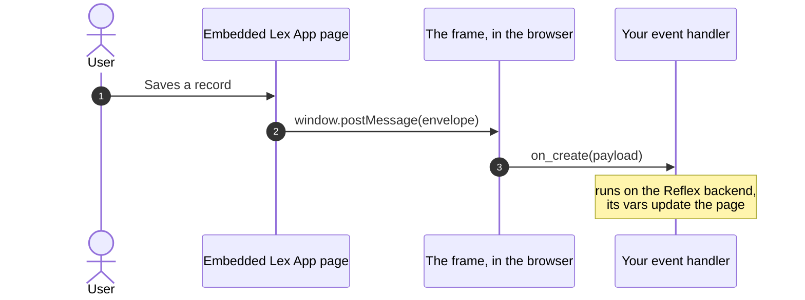

`lex_view()` puts a real Lex App page — a table, a form, a record — inside a Reflex dashboard. It is the application's own page, not a copy of it: the same saved views, filters, validation and permissions, inside a frame on your page.

It is the Reflex twin of Streamlit's `lex_view` — [[access-and-dashboards/streamlit/embedding app pages|Embedding App Pages]] there — over the same contract: the same address in front of Lex App's interface, the same events back, the same flows. What differs is how Reflex runs. A Streamlit script reruns with the event as `lex_view`'s return value; a Reflex page is compiled once, so an event **runs an event handler** of yours, and anything that changes at run time — the record to show, the filters — is a **state var**.

| Level | What you write | What you get |
|---|---|---|
| **Embed** | `lex_view("investor")` | Lex App's page in a frame |
| **React** | `lex_view("investor", on_select=Investors.select)` | The user's actions run your event handlers |
| **Chain** | `lex_view("investor/create", flow=…)` | The user is routed from one form to the next |

```python
from lex.lex_app.reflex import lex_view
```

## Basic usage

```python
import reflex as rx

from lex.lex_app.reflex import lex_view


class Investors(rx.State):
    selected: list[str] = []

    @rx.event
    def select(self, payload: dict):
        self.selected = [str(i) for i in payload.get("ids") or []]


def investors() -> rx.Component:
    return rx.vstack(
        lex_view("investor", height=420, on_select=Investors.select),
        rx.text("Selected: ", Investors.selected.join(", ")),
    )
```

`path` is the page as Lex App routes it, without a leading `/`: `"investor"` is the table, `"investor/create"` its create form, `"investor/42/show"` one record.

## Event handlers

Pass a handler for each kind of event you want. Passing one is what asks the page to send that kind — the page sends nothing you did not ask for:

| Argument | Runs when… | The handler gets |
|---|---|---|
| `on_create` | A create form saves | the payload: `resource`, `id`, `data` |
| `on_update` | An edit form saves | the payload: `resource`, `id`, `data` |
| `on_delete` | A record is deleted from the edit toolbar | the payload |
| `on_select` | The grid's selection changes | the payload: `resource`, `ids` |
| `on_navigate` | The embedded page routes somewhere else | the payload: `from`, `to` |
| `on_filter` | The table's filters change — see [Filtering the embedded table](#filtering-the-embedded-table) | the payload: `resource`, `filters`, `filter_model`, `row_count` |
| `on_flow_step` | Nothing today — see below | — |
| `on_event` | Any of the above | the whole envelope |

Each payload is the one Streamlit's `lex_view` returns; [[access-and-dashboards/streamlit/embedding app pages#Callback flags|Callback flags]] has every key. `data` on a create or update is the whole saved record, as the API returned it.

`on_event` gets the whole envelope — `source`, `version`, `type`, `id`, `ts` and `payload`, described under [[access-and-dashboards/streamlit/embedding app pages#The event envelope|The event envelope]]. Passing it asks the page for **every** kind of event. It runs beside the kind's own handler, not instead of it.

> [!warning] `on_flow_step` does not deliver an event today
> Lex App's interface never sends a `flow_step` event, so a handler passed as `on_flow_step` never runs. Flows themselves work — the routing happens inside the embedded page. To follow a flow's progress, use `on_create` and `on_update`, which run at each step that saves.

### How an event reaches your handler



There is no rerun and no polling. The frame passes each event to its handler once: an envelope with the same `id` as the one just before it is a repeat, and is dropped. And it believes only the page it framed: a message from any other window, from any origin but Lex App's, or of a newer protocol version than it knows, is ignored.

Because nothing reruns, there is no `key` to keep stable, as there is in Streamlit.

## A record named at run time

The page compiles once, before anyone visits it, so the record a dashboard is about is not known when `lex_view` is called. Make `path` a state var — or an f-string with one in it — and the frame's address is put together in the browser, from the var's current value:

```python
lex_view(f"fund/{FundRecord.pk}/show", height=600)
```

When the var changes, the frame opens the new address. [[access-and-dashboards/reflex/dashboards on your models|Dashboards on Your Models]] uses exactly this, to show Lex App's own record page beside a record dashboard.

## Redirect flows (`flow=`)

Flows are the same as in Streamlit, and so are their imports' names: `Flow`, `ref` and `STAY`, from `lex.lex_app.reflex`.

```python
from lex.lex_app.reflex import Flow, lex_view, ref

lex_view(
    "investor/create",
    flow=Flow().create("investor", as_="inv").create("vehicle").update("investor", id=ref("inv")).table("investor"),
    on_create=Investors.created,
)
```

The mapping form, the sequence form, `STAY`, `ref`, what `Flow` rejects with `FlowError` and how the two forms cannot be mixed: all of it is on Streamlit's page, under [[access-and-dashboards/streamlit/embedding app pages#Redirect flows (flow=)|Redirect flows]], and holds here word for word. A flow wins over `redirect_after`, `redirect_after_create` and `redirect_after_update`, which work as they do there.

## Filtering the embedded table

An embedded table can open already filtered, follow filters your state holds, and tell a handler when its filters change.

`filters` is one of three things:

| You pass | It means |
|---|---|
| A dict — `{"status": ["open", "overdue"], "region": 3}` | Fixed filters, checked when the page is built |
| A dict naming state vars — `{"fund": FundRecord.pk}` | Filters read in the browser, from the vars' current values, and sent again whenever they change |
| A state var holding such a dict — `Orders.line_filters` | Filters that follow the var: each time it changes, they are sent into the frame, and the table refilters in place, without a reload |

A dict naming a var behaves as a var does: its filters are sent into the frame after it loads, not checked when the page is built.

Values are the stored ones, as for Streamlit: a list picks those values, one value picks just it, `None` or an empty list clears the column. [[access-and-dashboards/streamlit/embedding app pages#Setting the filters|Setting the filters]] has the rules — what a column accepts, how the filters combine with the user's own, and why sending the same filters again changes nothing.

### Linking two tables

Pick orders in one table, show their lines in the other:

```python
import reflex as rx

from lex.lex_app.reflex import lex_view


class Orders(rx.State):
    line_filters: dict = {}

    @rx.event
    def pick(self, payload: dict):
        self.line_filters = {"order": [str(i) for i in payload.get("ids") or []]}


def orders() -> rx.Component:
    return rx.vstack(
        lex_view("order", height=360, on_select=Orders.pick),
        lex_view("order_line", height=360, filters=Orders.line_filters),
    )
```

Each selection runs `pick`, the var changes, and the lines table refilters. With nothing selected, the list is empty and the lines table shows every line.

### Hearing filter changes

`on_filter` runs each time the table's filters change, whether the user changed them or your `filters` did, about 300 ms after the table reloads. Its payload's keys are under [[access-and-dashboards/streamlit/embedding app pages#Hearing filter changes|Hearing filter changes]]. Don't feed a table's own filters back into its `filters`: the frame keeps the user's picks itself.

### Allowed sites

Filters sent into the frame after it loads, and the `filter` event, only work for a dashboard whose address Lex App has been given: the dashboards' origin in `LEX_EMBED_ALLOWED_ORIGINS` — `http://localhost:8502` locally, and on a deployment the origin of `REFLEX_URL` and of every other hostname the dashboards answer on.

```bash
LEX_EMBED_ALLOWED_ORIGINS=https://dashboards.example.com,http://localhost:8502
```

With a plain dict, the first filters travel in the frame's address, so a table opens filtered even without it — unless the encoded filters pass 2,000 characters. With a var, or a dict naming one, **every** filter is sent into the frame, the first included, so such a table needs the setting from the start. What else the setting changes is under [[access-and-dashboards/streamlit/embedding app pages#Allowed sites|Allowed sites]].

## Other options

| Argument | Default | What it does |
|---|---|---|
| `height` | `800` | The frame's height, in pixels. It is always as wide as its container |
| `hide_toolbar` | `False` | Hides the toolbar above the grid, the **Create** button with it |
| `hide_actions` | `False` | Hides each row's Actions column |
| `redirect_after`, `redirect_after_create`, `redirect_after_update` | none | Where a form goes after saving; `{id}` is the saved record's id. A `flow` wins over them |
| `serializer` | none | The serializer the embedded list reads with — see [[model-your-data/serializers\|Serializers]] |
| `extra_params` | none | More query parameters for the page, applied last |
| `base_url` | see below | Lex App's address, when the default would be wrong |
| `title` | `"lex-app"` | The frame's accessible title |

What `hide_toolbar` and `hide_actions` leave alone, and how `extra_params` overrides `lex_view`'s own, is as in Streamlit: see [[access-and-dashboards/streamlit/embedding app pages#Existing embed options still work|Existing embed options]].

## Where the frame points

The frame's address starts from `base_url` when you pass one. Otherwise, from the first of these:

1. `REACT_APP_URL`, then `LEX_FRONTEND_URL`.
2. The application hostname on the **same registrable domain** as the dashboards' own canonical hostname — the one `REFLEX_URL` or `LEX_REFLEX_HOSTS` names. A frame on another registrable domain is a third-party context, and the browser withholds its cookies, so the framed page could not stay signed in.
3. `http://localhost:8000`, a local `lex start`.

Then, in the browser, one more rule: when Lex App itself frames the dashboard, from one of [[access-and-dashboards/reflex/design system#Who may frame a dashboard|its origins]], the page is opened on the origin Lex App was reached on instead — a customer's own domain attached to the instance included — so it carries the session the user has there. The framing origin is the one the browser names to the dashboard; Firefox names none, so there it is taken from the dashboard's referrer, the page that framed it. With neither, the frame keeps the address above.

Events are believed only from the origin the frame was opened on. A frame actually served from somewhere else — `http` against `https`, another port, `localhost` against `127.0.0.1` — loads and works, and no handler ever runs.

## Light and dark

There is no `theme` argument, and nothing to pass. An embedded page follows Lex App's own light or dark choice, and so does the dashboard around it — see [[access-and-dashboards/reflex/design system#Light and dark|Light and dark]].

## Coming from Streamlit

| | Streamlit | Reflex |
|---|---|---|
| An event | reruns the script; `lex_view` returns it | runs the handler you passed |
| Asking for an event | `on_select=True` | `on_select=State.handler` |
| Every event | one flag per kind | `on_event` |
| The record to show | computed in the rerun | a state var in `path` |
| Changing filters | a different dict on a rerun | a state var holding the dict, or a dict naming state vars |
| `key` | keeps the return value across reruns | none — nothing reruns |
| `width`, `scrolling` | in a plain embed | none — the frame is always full width |
| `theme` | accepted, never read | none |
| `title` | none | the frame's accessible title |

## Related

- [[access-and-dashboards/reflex/embedding app controls|Embedding App Controls]] — Lex App's controls, rather than a whole page
- [[access-and-dashboards/reflex/tables and records|Tables & Records]] — a model's rows drawn by the dashboard itself, through Lex App's API
- [[access-and-dashboards/streamlit/embedding app pages|Streamlit's Embedding App Pages]] — the shared contract, in full
- [[reference/Environment Variables#Embedding|Environment Variables]] — `LEX_EMBED_ALLOWED_ORIGINS`
