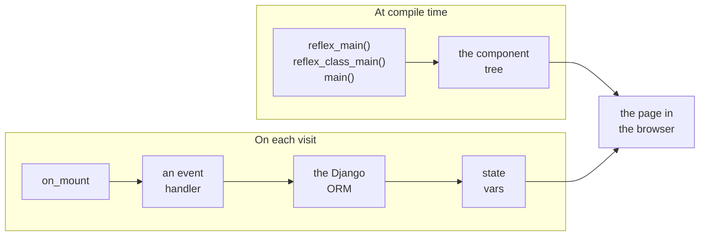
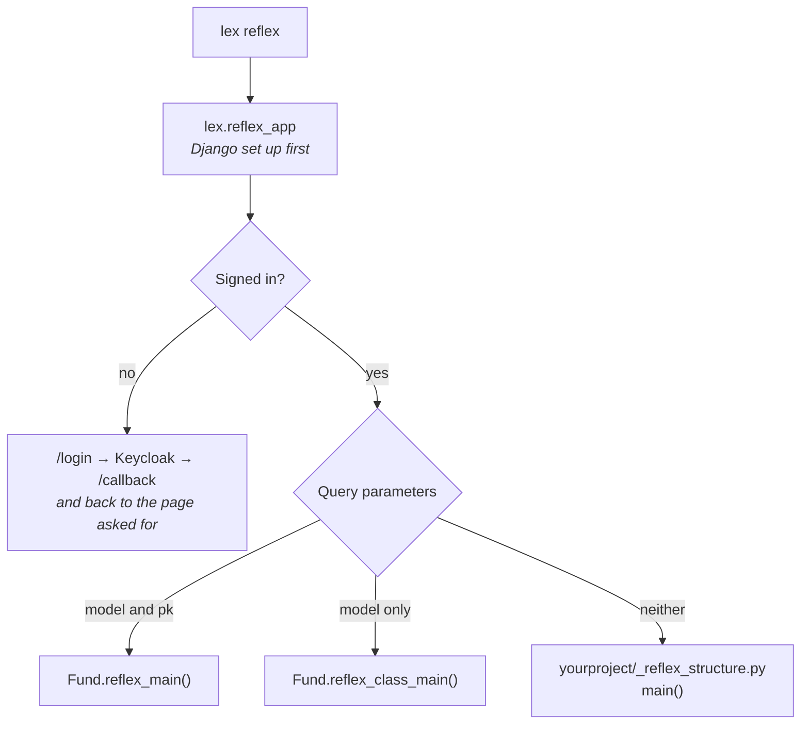

A Lex App project can write its dashboards in [Reflex](https://reflex.dev/docs/) — Python that compiles to a React app — as well as, or instead of, [[access-and-dashboards/streamlit/index|Streamlit]]. A Reflex dashboard takes the same place in Lex App as a Streamlit one: a `lex` command and an IDE run configuration, the same `?model=&pk=` links and Analytics tab, an entry in the sidebar, the project's own models — through Lex App's API as the user, or the Django ORM — and the signed-in user from the same Keycloak.

What differs is how Reflex runs, and it changes how you write a dashboard. A Streamlit script runs top to bottom on every interaction, so a dashboard is code that draws. A Reflex app is **compiled ahead of time** into a frontend that talks to a Python backend over a WebSocket. A dashboard is a component tree, built once, and its data lives in a **state** whose event handlers fill it in, per user, at run time.

Every Reflex dashboard is drawn with **RFDS**, the Reflex Finance Design System: its components, charts, tables and page templates, in Lex App's colours. Lex App configures RFDS for you — the plugins, the brand, how numbers and dates are written, the chrome around each page, who may frame a dashboard — and you write the pages with it. [[access-and-dashboards/reflex/design system|Design System]] draws the line between the two.



## Streamlit and Reflex, side by side

| | Streamlit | Reflex |
|---|---|---|
| Run it | `lex streamlit` | `lex reflex` |
| Locally at | `:8501` | `:8502`, backend `:8503` |
| In Lex App's sidebar | `IS_STREAMLIT_ENABLED` | `IS_REFLEX_ENABLED` |
| A record's dashboard | `streamlit_main(self)` | `reflex_main(cls)` |
| A table's dashboard | `streamlit_class_main(cls)` | `reflex_class_main(cls)` |
| The Analytics tab opens it | when the model has one | when the model has one and Reflex is on — it wins over Streamlit's |
| The project's own | `_streamlit_structure.py` | `_reflex_structure.py` |
| More pages | Streamlit's own | `@lex_page`, in Lex App's chrome |
| The look | Streamlit's theme | RFDS, in Lex App's colours |
| Signing in | a proxy in front | inside the app |
| A model's rows | the ORM | `lex_table`, `lex_grid`, `lex_api` — Lex App's API, as the user |
| The ORM | call it | async, or `run_orm` |
| Permissions | `st.session_state` | `current_permissions`, `has_permission`, `permission` |
| Lex App's pages inside | `lex_view` returns the event on a rerun | `lex_view` runs your event handler |
| Lex App's controls inside | `with lex_widgets() as page:` | `lex_widgets(calculation(...))` |
| Starting a page | — | `lex reflex add`, and `lex reflex check` |

A record's Reflex dashboard is a component, not code that runs with the record: its state reads the record with `LexRecordState` or `current_record`. Signing in is [Reflex Enterprise](https://reflex.dev/docs/enterprise/auth/overview/)'s `AuthPlugin`, with no proxy in front, and `has_permission` turns a permission into an `auth=` check.

## Two imports

A dashboard takes its UI from `rfds` — and plain `reflex` where RFDS has nothing to say — and everything that knows about Lex App from one place:

```python
import reflex as rx
import rfds

from lex.lex_app.reflex import lex_page, lex_table, permission
```

| Name | What it is | Where |
|---|---|---|
| `lex_page` | A signed-in page in Lex App's chrome — `@rx.page`'s twin | [[access-and-dashboards/reflex/design system#Pages in Lex App's chrome: lex_page\|Design System]] |
| `lex_chrome` | Any component in Lex App's chrome | [[access-and-dashboards/reflex/design system\|Design System]] |
| `permission` | The RFDS permission string for a Keycloak scope on a model | [[access-and-dashboards/reflex/design system#What a user may see\|Design System]] |
| `LexAccessState` | Loads the user's grants for RFDS's `can()` and the navigation | [[access-and-dashboards/reflex/design system#What a user may see\|Design System]] |
| `lex_api`, `LexApiError` | Lex App's REST API as the signed-in user, and what it raises | [[access-and-dashboards/reflex/tables and records\|Tables & Records]] |
| `lex_table`, `LexTableState` | RFDS's table over a model, paged on the server, and its state | [[access-and-dashboards/reflex/tables and records\|Tables & Records]] |
| `lex_grid` | RFDS's AG Grid over up to 2,000 of a model's rows | [[access-and-dashboards/reflex/tables and records\|Tables & Records]] |
| `lex_columns`, `lex_grid_columns` | Column specs for a model's fields | [[access-and-dashboards/reflex/tables and records#Columns\|Tables & Records]] |
| `LexRecordState` | The record `?model=&pk=` names, only if the API shows it to the user | [[access-and-dashboards/reflex/tables and records\|Tables & Records]] |
| `lex_rows` | A queryset as rows for a chart, inside `run_orm` | [[access-and-dashboards/reflex/tables and records\|Tables & Records]] |
| `lex_view` | One Lex App page — a table, a form, a record — in the dashboard | [[access-and-dashboards/reflex/embedding app pages\|Embedding App Pages]] |
| `Flow`, `ref`, `STAY` | Chained forms, exactly as in Streamlit | [[access-and-dashboards/reflex/embedding app pages\|Embedding App Pages]] |
| `lex_widgets`, `calculation`, `calculation_log` | Lex App's controls, several in one frame | [[access-and-dashboards/reflex/embedding app controls\|Embedding App Controls]] |
| `lex_calculation`, `lex_calculation_log`, `lex_calculation_log_tree` | One control, in a frame of its own | [[access-and-dashboards/reflex/embedding app controls\|Embedding App Controls]] |
| `current_record` | The record `?model=&pk=` names, read through the ORM | [[access-and-dashboards/reflex/dashboards on your models\|Dashboards on Your Models]] |
| `LexDashboardState` | What `/` shows, and whether Lex App frames it | [[access-and-dashboards/reflex/standalone dashboards#Framed by Lex App\|Standalone Dashboards]] |
| `run_orm` / `orm` | Synchronous Django code, run from an async event handler | [[access-and-dashboards/reflex/the django orm\|The Django ORM]] |
| `current_permissions` | The signed-in user's Keycloak UMA permissions | [[access-and-dashboards/reflex/sessions and authentication\|Sessions & Authentication]] |
| `has_permission` | An `auth=` check built from one of them | [[access-and-dashboards/reflex/sessions and authentication\|Sessions & Authentication]] |
| `current_access_token` | The user's Keycloak access token | [[access-and-dashboards/reflex/sessions and authentication\|Sessions & Authentication]] |
| `LexUser` | The signed-in user's names, as vars a component can show | [[access-and-dashboards/reflex/sessions and authentication\|Sessions & Authentication]] |
| `LexKeycloakAuthState` | The sign-in itself: Reflex Enterprise's provider, pointed at Keycloak | [[access-and-dashboards/reflex/sessions and authentication\|Sessions & Authentication]] |
| `lex_config`, `lex_auth_plugin` | The configuration a project's `rxconfig.py` returns, and its sign-in plugin | [[access-and-dashboards/reflex/running and deploying\|Running & Deploying]] |

## What to read, in order

| Page | Answers |
|---|---|
| [[access-and-dashboards/reflex/dashboards on your models\|Dashboards on Your Models]] | How do I attach a dashboard to a model, for one record or the whole table? |
| [[access-and-dashboards/reflex/standalone dashboards\|Standalone Dashboards]] | How do I write the project's own dashboard, with pages of its own? |
| [[access-and-dashboards/reflex/design system\|Design System]] | What does Lex App set up for me, and what do I write with RFDS? |
| [[access-and-dashboards/reflex/tables and records\|Tables & Records]] | How do I show a model's rows, and one record, as the user may see them? |
| [[access-and-dashboards/reflex/the django orm\|The Django ORM]] | How do I read and write my models from an event handler? |
| [[access-and-dashboards/reflex/embedding app pages\|Embedding App Pages]] | How do I put Lex App's own table, form or record page in a dashboard? |
| [[access-and-dashboards/reflex/embedding app controls\|Embedding App Controls]] | How do I put the real Calculate button and its log in a dashboard? |
| [[access-and-dashboards/reflex/sessions and authentication\|Sessions & Authentication]] | Who is signed in, what may they see, and what does Keycloak need? |
| [[access-and-dashboards/reflex/consultant tooling\|Consultant Tooling]] | How do I start a page from a template, and check it the way CI does? |
| [[access-and-dashboards/reflex/running and deploying\|Running & Deploying]] | How do I run it locally, and what does production need? |

> [!important] Reflex Enterprise
> Signing in comes from [Reflex Enterprise](https://reflex.dev/docs/enterprise/overview/), which lex-app installs together with Reflex. It is free during development once the machine is signed in to Reflex — `lex reflex login`, once — and running in production mode needs a paid Reflex tier. [[access-and-dashboards/reflex/running and deploying|Running & Deploying]] has the details.

## Which one runs

One Reflex app serves every kind of dashboard, and the query string decides which you get — exactly as it does for Streamlit:



`?model=fund&pk=42` is the record's dashboard and `?model=fund` the table's — [[access-and-dashboards/reflex/dashboards on your models|Dashboards on Your Models]]. With neither, `/` shows [[access-and-dashboards/reflex/standalone dashboards|the project's own dashboard]], and any further pages the project declares have routes of their own.

With `IS_REFLEX_ENABLED=true`, Lex App's sidebar gains a **Reflex** entry that frames the project's own dashboard, the way the Streamlit entry frames Streamlit's. The record page's [[using-the-app/record-detail/analytics tab|Analytics tab]] and the table's Analytics toggle open a model's Reflex dashboard when it has one, and its Streamlit dashboard otherwise — the rule is under [[access-and-dashboards/reflex/dashboards on your models#Where they show up|Where they show up]].

## Coming from Streamlit

Everything a Streamlit dashboard can embed, a Reflex dashboard can too. `lex_view` and `lex_widgets` exist in both, over one contract: the same address in front of Lex App's interface, the same events back, the same flows and the same widget specs. What changes is how an event arrives. A Streamlit script reruns, and `lex_view` returns the event; a Reflex page runs the event handler you passed, and whatever changes at run time — the record, the filters — is a state var. [[access-and-dashboards/reflex/embedding app pages|Embedding App Pages]] and [[access-and-dashboards/reflex/embedding app controls|Embedding App Controls]] each end with the differences, side by side.

The two can run side by side: `lex streamlit` and `lex reflex` use different ports, a project can carry both a `_streamlit_structure.py` and a `_reflex_structure.py`, and a model can define both kinds of dashboard. To move a project's dashboards over one at a time, set `LEX_DASHBOARD_SURFACE=streamlit` until the Reflex ones are ready: the Analytics tab then keeps opening Streamlit's, whatever the models define.
