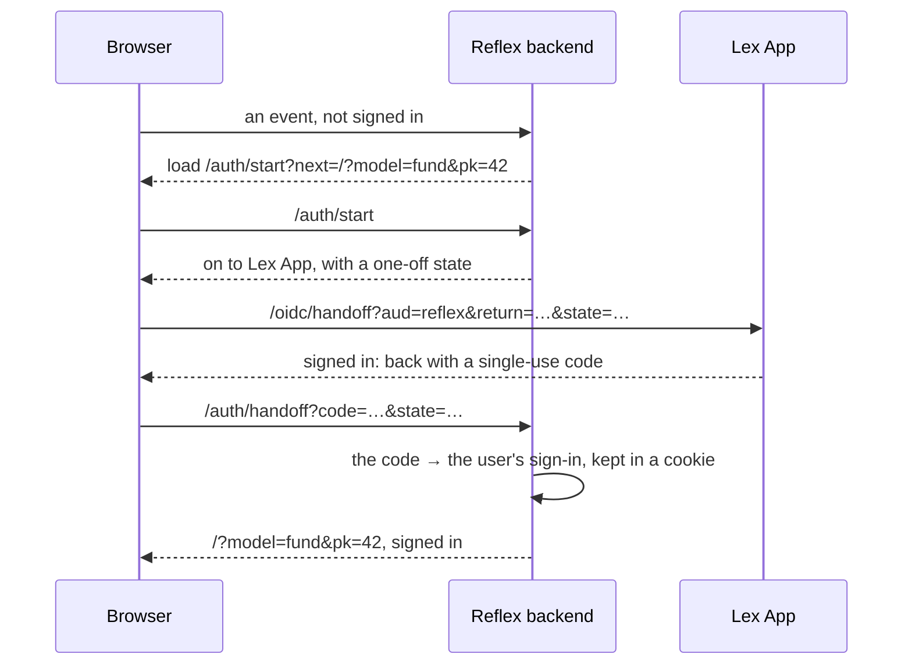

A Reflex dashboard runs as the person looking at it, and it signs them in through Lex App. It borrows the user's Lex App sign-in through the dashboard hand-off — the same one a [[access-and-dashboards/streamlit/sessions and authentication|Streamlit]] dashboard uses with `LEX_STREAMLIT_AUTH=handoff` — so it runs no sign-in of its own, needs nothing registered in Keycloak, and never puts a token in the browser. This page is what happens, and what to configure.

## Every page requires sign-in

Every event handler runs only for a signed-in user. A visitor who is not signed in is sent through the sign-in by the page's first event — every `lex_page`, and `/`, send one as they load — and comes back to the page they were on, query string included, so `?model=fund&pk=42` survives the round trip. Someone already signed in to Lex App sees nothing but a reload: the dashboard asks Lex App, Lex App answers at once, and the page opens signed in.



The code is good once, for 60 seconds, and only for the dashboard host and the browser that asked for it. The backend trades it for an opaque handle to the user's Lex App sign-in, which it keeps in an HttpOnly cookie, `lex_rdash`; the database stores only the handle's hash.

Not signed in to Lex App either, the visitor gets:

- **In a tab of its own** — Lex App's sign-in page, and then the dashboard they asked for.
- **Inside Lex App's frame** — a short page saying the sign-in has ended. Keycloak's login page never opens inside a frame, so the dashboard tells Lex App's interface instead, in the `lex-auth` contract (`required`, surface `reflex`); Lex App can then sign the user in again and reload the dashboard. Opened on its own, the same page offers **Sign in again**.

Nothing a dashboard declares can be public: there is no `auth=False`. The check runs on events, so load a page's data in an event handler — `on_load`, `on_mount` or a click — rather than in a computed var.

## Inside Lex App's frame

Framed by Lex App — the **Reflex** entry in the sidebar — the dashboard behaves the same with two differences:

- **Signing in needs no click.** The hand-off runs inside the frame, against the sign-in the user already has in Lex App.
- **The dashboard's own header is left out.** Lex App opens it with `lex_embed=1`, and the page then draws neither the signed-in user nor a **Sign out** button: Lex App's header shows both. Your components can do the same — see [[access-and-dashboards/reflex/standalone dashboards#Framed by Lex App|Framed by Lex App]].

Over HTTPS the cookie is `__Host-lex_rdash`: `HttpOnly`, `Secure`, `SameSite=None` and `Partitioned`, so the browser keeps it inside Lex App's frame — a partitioned cookie is accepted even where third-party cookies are blocked. Over plain HTTP, for development on `localhost`, it is `lex_rdash` with `SameSite=Lax`.

The hand-off reads Lex App's own sign-in cookie from inside the frame, so it goes to the Lex App host that shares a site with the dashboards. Put them on a host beside Lex App — `dashboards.example.com` next to `app.example.com` — and list both, as under [What to configure](#what-to-configure). A browser that still keeps no cookie in the frame is not sent round in circles: after two hand-offs that left no cookie, the dashboard shows a page saying so, with a link that opens it in a tab of its own.

## What to configure

### In development: nothing

`lex start` on `http://localhost:8000` and `lex reflex` on `http://localhost:8502` find each other. On an instance that is not deployed (no `DEPLOYMENT_ENVIRONMENT`), any loopback address — `localhost`, `127.0.0.1` — may take part in the hand-off, and a dashboard with no Lex App host configured hands off to `http://localhost:8000`.

Nothing goes into Keycloak, and nothing new into `.env`. A dashboard needs no Keycloak client and no redirect URI; entries made for the earlier Reflex sign-in — `http://localhost:8502/callback` and the like — are no longer used, and neither are `LEX_KEYCLOAK_*` and `OIDC_ISSUER_URI` / `OIDC_CLIENT_ID` / `OIDC_CLIENT_SECRET`. The user's permissions are looked up with the Keycloak settings the project already has.

### In production

The dashboards and Lex App must know each other's address, on both sides. The Lex App backend hands a sign-in only to a dashboard host it lists, and the dashboards hand off only to a Lex App host they list:

| Both read | Holding |
|---|---|
| `LEX_INSTANCE_HOSTS` | its `reflex` and `app` entries |
| without it: `REFLEX_URL` and `DOMAIN_HOSTED` | the dashboards' and Lex App's addresses |

Hosted instances get both from the platform. A dashboard reached on a host the instance does not list answers *Not a dashboard* instead of signing anyone in.

- **The same database.** The dashboards redeem the code against Lex App's database, which they already use for the ORM.
- **The public scheme and host.** Behind a reverse proxy, forward them (`X-Forwarded-Proto`, `X-Forwarded-Host`): the hand-off builds the address it comes back to from them.
- **`/auth/` on the backend.** The backend answers four routes of its own: `/auth/start`, `/auth/handoff`, `/auth/logout` and `/auth/blocked`. An ingress that sends the whole dashboard host to Reflex needs nothing more; one that routes by path must send `/auth/` to the backend too.

## Staying signed in

A dashboard stays signed in exactly as long as the Lex App sign-in it was handed — weeks, not minutes; see [[access-and-dashboards/sign-in and sessions|Sign-in & Sessions]]. The cookie lasts 30 days; after that, or whenever it is missing, the next event runs the hand-off again, with nothing to click while the user is signed in to Lex App.

- **Signing out ends it.** Signing out of Lex App, Keycloak ending the session — back-channel logout included — or an administrator deactivating the user ends the dashboard's sign-in too. Each Reflex process looks a sign-in up at most once a minute, so the dashboard notices within about 60 seconds, at its next event, and goes through the hand-off; inside Lex App's frame, Lex App is told the user must sign in again.
- **An outage does not.** That look-up reads the database, not Keycloak, so a Keycloak outage signs nobody out. Only the access token can run out: Lex App serves the one it has while it is valid, and after that `current_access_token` returns `""` until Keycloak answers again.
- **Restarts and new tabs** find the user signed in. The sign-in lives in Lex App's database and the handle in the browser, so `lex reflex` run again, a deployment, another replica or another tab all read the same one. Nothing about it needs Redis.

The cookie never reaches the page's scripts, and never the page's state either. Reflex copies the event channel's request headers into the state, which the browser receives, so on that channel the backend replaces the cookie with `X-Lex-Binding` — a hash of the handle, useless anywhere but on the server.

**Signing out.** **Sign out** in the user menu opens `/logout`, which ends the dashboard's sign-in, removes its cookie, and signs the user out of Lex App and Keycloak, like Lex App's own sign-out. `LexUser.sign_out` is the same as an event: `rx.button("Sign out", on_click=LexUser.sign_out)`.

## Who is signed in

In a component, the user is a set of vars:

| Var | Holds |
|---|---|
| `LexUser.display_name` | the name, else the username, else the email |
| `LexUser.username` | Keycloak's `preferred_username` |
| `LexUser.email` | the email address |
| `LexUser.sub` | Keycloak's stable user ID |

```python
import reflex as rx

from lex.lex_app.reflex import LexUser


def greeting() -> rx.Component:
    return rx.text("Signed in as ", LexUser.display_name, " (", LexUser.email, ")")
```

All are empty until sign-in. In an event handler, RFDS's `current_identity(self)`, from `rfds.auth`, returns the user — `sub`, `email`, `name` — or `None`.

## What they may see

The ORM reads as the dashboard, **not** as the user. Lex App's [[access-and-dashboards/permissions|permission methods]] — `permission_read` and the rest — guard the API and the grid; a query in a handler returns whatever it asks for. Decide what a user may see with their Keycloak permissions:

**`current_permissions(self)`** returns the user's Keycloak UMA permissions — the list a Streamlit dashboard reads from `st.session_state.permissions`, one `{"rsname": …, "scopes": […]}` entry per resource:

```python
import reflex as rx

from lex.lex_app.reflex import current_permissions


class Overview(rx.State):
    resources: list[str] = []

    @rx.event
    async def load(self):
        permissions = await current_permissions(self)
        self.resources = sorted({p["rsname"] for p in permissions})
```

It asks Keycloak once per access token, and again after each renewal, so a changed role takes effect within minutes. If Keycloak cannot answer, the user keeps what they were last granted while the access token is valid; someone Keycloak never answered for gets nothing, and so does everyone whose access token has expired and cannot be renewed.

**`has_permission(target, scope)`** turns one of them into a check, and **`lex_event`** puts the check on an event handler — `rx.event` with an `auth=`:

```python
import reflex as rx

from Input.Fund import Fund
from lex.lex_app.reflex import has_permission, lex_event, run_orm


def _fund_count() -> str:
    return str(Fund.objects.count())


def _round_budgets() -> None:
    for fund in Fund.objects.all():
        fund.budget = round(fund.budget)
        fund.save()


class FundActions(rx.State):
    fund_count: str = ""

    @lex_event(auth=has_permission(Fund, "read"))
    async def load(self):
        self.fund_count = await run_orm(_fund_count)

    @lex_event(auth=has_permission(Fund, "edit"))
    async def round_budgets(self):
        await run_orm(_round_budgets)
```

`target` is a model — resolved to the Keycloak resource Lex App registers for it, `<app_label>.<ModelName>` — or a resource name as a string. `scope` is one of the scopes Lex App registers: `list`, `read`, `create`, `edit`, `delete`, `export`; `read` when left out. Only a **model-wide** grant counts: a grant scoped to single records does not open a check on the whole model, the same rule the API's default read check follows.

The check runs before the handler. A denied event shows RFDS's *not permitted* notice, and the handler never runs. `auth=` takes one check or a list, and RFDS's own `requires(...)` or any `async (ctx) -> bool` as well. Without `auth=`, `lex_event` is `rx.event`: any signed-in user may send it. To check in the middle of a handler instead, call the check with the state: `if await has_permission(Fund, "edit")(self):`.

Checks guard handlers, not vars: a var holds what a handler put in it. For a page only some users may open, check the handlers that load its data.

What a user **sees** follows the same grants. `permission(Fund, "edit")` spells a grant as the string RFDS checks, and RFDS's `can(...)` shows a part of a page only to users who hold it; `lex_page(requires=...)` does the same for a whole page and its navigation entry. That decides what is drawn, not what is allowed — keep the `auth=` check on the handler. See [[access-and-dashboards/reflex/design system#What a user may see|What a user may see]].

A file RFDS's export prepares (`ExportMixin`) downloads only for the user who started the export.

## Calling the Lex App API as the user

For a model's records, `lex_api(self)` does all of this for you — the token, the address, the errors — and `lex_table`, `lex_grid` and `LexRecordState` build on it: see [[access-and-dashboards/reflex/tables and records|Tables & Records]]. For any other endpoint, call the API yourself.

`current_access_token(self)` returns the signed-in user's Keycloak access token, from their Lex App sign-in. Sent as a bearer token, it calls the Lex App API as that user, so their permissions apply exactly as they do in the grid:

```python
import httpx
import reflex as rx

from lex.lex_app.reflex import current_access_token


class Funds(rx.State):
    rows: list[dict] = []

    @rx.event
    async def load(self):
        token = await current_access_token(self)
        async with httpx.AsyncClient(base_url="http://localhost:8000") as client:
            response = await client.get(
                "/api/model_entries/fund/list",
                params={"perPage": -1},
                headers={"Authorization": f"Bearer {token}"},
            )
        self.rows = response.json()["results"]
```

`http://localhost:8000` is `lex start` locally; in production it is wherever the dashboard reaches the Lex App backend. The token never reaches the browser, and it is always a current one: Lex App renews it, once for every dashboard and tab on the same sign-in. With no sign-in, an ended one, or Keycloak unreachable once the token has expired, `current_access_token` returns `""` — no call can be made as the user then.

The list is paged only when the request sends `perPage`: then it answers `{"count", "next", "previous", "results"}`, and `-1` puts every row in that one page. Without `perPage` it answers a plain array of every row — read `response.json()` itself then. See [[reference/REST API#The list endpoint|The list endpoint]].

## Related

- [[access-and-dashboards/sign-in and sessions|Sign-in & Sessions]] — the Lex App sign-in a dashboard borrows
- [[access-and-dashboards/permissions|Permissions]] — the scopes and resources `has_permission` checks
- [[access-and-dashboards/reflex/design system|Design System]] — `permission`, `can` and `lex_page(requires=...)`
- [[access-and-dashboards/reflex/tables and records|Tables & Records]] — `lex_api`, and a model's rows as the user may see them
- [[access-and-dashboards/reflex/running and deploying|Running & Deploying]] — HTTPS, public URLs and the rest of production
- [[reference/Environment Variables|Environment Variables]] — every setting named on this page
