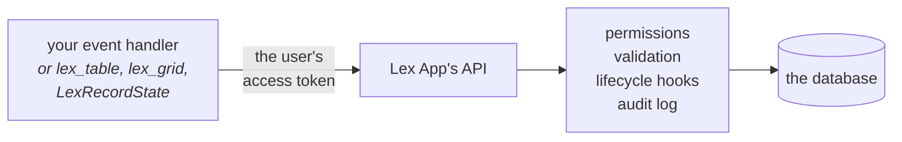

A dashboard that shows a model's rows should show what the grid shows that user — no more. So every row a Reflex dashboard reads with the helpers on this page comes through **Lex App's own REST API, called as the signed-in user**, and every write goes there too.



That is the point of going the long way round. The API is the code the grid itself calls, so the dashboard gets the same model and row permissions, the same field filtering, the same validation and [[model-your-data/lifecycle hooks|lifecycle hooks]], the same audit log and calculations — the same code, not a copy of it. A query through the [[access-and-dashboards/reflex/the django orm|Django ORM]] runs as the dashboard instead, and returns whatever it asks for.

| Helper | What it gives you |
|---|---|
| `lex_api` | The API itself, for reads and writes in a handler of your own |
| `lex_table` | RFDS's table over a model, paged on the server |
| `lex_grid` | RFDS's AG Grid over a model's rows, up to 2,000 of them |
| `lex_columns` / `lex_grid_columns` | Column specs for a model's fields, for either |
| `LexRecordState` | The record `?model=&pk=` names — only if the API would show it to this user |
| `lex_rows` | A queryset as rows for a chart, read through the ORM inside `run_orm` |

All of them are imported from `lex.lex_app.reflex`.

## `lex_api`: the API as the user

`await lex_api(self)`, in an event handler, returns the API for the user signed in to that session:

```python
import reflex as rx

from Input.Fund import Fund
from lex.lex_app.reflex import LexApiError, lex_api


class FundActions(rx.State):
    pk: str = ""
    outcome: str = ""

    @rx.event
    async def approve(self):
        try:
            api = await lex_api(self)
            await api.update(Fund, self.pk, {"status": "approved"})
        except LexApiError as exc:
            self.outcome = "Not allowed." if exc.denied else f"Lex App refused it: {exc.detail}"
            return
        self.outcome = "Approved."
```

| Call | Does |
|---|---|
| `await api.list(model, page=1, per_page=25, ordering=None, params=())` | One page of records: `{"count": n, "results": [...]}` |
| `await api.get(model, pk)` | One record, as the API serialises it |
| `await api.create(model, data)` | Creates a record as the user, and returns it |
| `await api.update(model, pk, data)` | Changes the fields in `data` and leaves the rest alone |
| `await api.delete(model, pk)` | Deletes a record as the user |

`model` is the model class, or its id — the lowercase model name, `"fund"`. `ordering` is a field, `"-name"` for descending, or several separated by commas. `params` are the list's filters as pairs: `("status", "open")`, a lookup such as `("amount__gte", "100")`, `("status!", "closed")` to exclude, a field repeated for any of several values. The endpoints are the ones Lex App's interface calls; see [[reference/REST API|REST API]].

Each write carries an operation id of its own, `<model>_<action>_<random>`, which the [[history-and-audit/index|audit log]] records it under, as it does a change made in the grid.

### When the API says no

A refusal never looks like an empty result. Every call that fails raises `LexApiError`:

| Attribute | Holds |
|---|---|
| `status` | The HTTP status. `0` when the API could not be reached at all |
| `detail` | The API's answer: its JSON, or the first 500 characters of its text |
| `denied` | `True` for `401`, `403` and `404` — the user may not do this, or the record is not theirs to see |

`lex_api` itself raises it, with `401`, when nobody is signed in, or their access token has expired and not been renewed yet. A call that takes longer than 30 seconds fails too, as status `0`.

### Where it reaches the API

The Reflex backend calls the API server to server, so it needs an address it can reach:

1. `LEX_API_URL`, when set. Inside a cluster, the application's internal service address.
2. Otherwise `https://` and `DOMAIN_HOSTED`, the instance's public hostname.
3. Otherwise `http://localhost:8000`, a local `lex start`.

`OIDC_VERIFY_SSL=false` turns off certificate checks on these calls too, for a local setup with a self-signed certificate.

## `lex_table`: a table paged on the server

```python title="_reflex_structure.py"
import reflex as rx
import rfds

from Input.Fund import Fund
from lex.lex_app.reflex import lex_page, lex_table, permission


@lex_page("/funds", title="Funds", nav="Finance", requires=permission(Fund, "read"))
def funds() -> rx.Component:
    return rfds.page(
        rfds.page_header(title="Funds", path="/funds"),
        lex_table(Fund, fields=["name", "status", "budget"]),
    )
```

RFDS's `data_table` over the model, asking the API for exactly the page on screen: sorting, the user's column filters and the quick search all go to the server, so a table of a million rows sends the browser one page.

| Argument | Default | What it does |
|---|---|---|
| `model` | — | The model class |
| `filters` | none | Fixed filters, `{field: value}` — see below |
| `fields` | the model's visible fields | The columns to show, by field name |
| `columns` | — | RFDS column specs, replacing `fields` entirely — see [Columns](#columns) |
| `caption` | the model's plural name | The table's accessible caption |
| `search_field` | the first plain text field | The field the quick search matches, ignoring case. `""` turns the search off |
| `page_size` | `25` | The rows the table opens at, also offered as a choice beside 25, 50 and 100. At most 200 |
| anything else | | Passed on to `rfds.data_table`: `row_href`, `on_row_click`, `toolbar`, `density` and the rest |

**Fixed filters** narrow the table before the user filters it, and the user cannot remove them. A value can be a state var — the record the page is about, say — and is read when the table appears:

```python
lex_table(Position, filters={"fund": FundRecord.pk})
```

A list value matches any of its values; `None` or `""` leaves the field unfiltered. The filters are read once, when the table mounts: changing the var afterwards does not filter the table again.

The default search field is the first text field without choices. A model with none has no quick search unless you name a field.

Each table keeps its own state: two tables of one model on a page, filtered differently, show their own rows. A fixed filter's var counts by its name, so `{"fund": FundRecord.pk}` and `{"fund": OtherRecord.pk}` are two tables. Only tables alike in model, columns, search field, page size and fixed filters share one state, and page and sort together.

## `lex_grid`: AG Grid over up to 2,000 rows

```python
lex_grid(Fund, status_bar=True)
```

RFDS's AG Grid, with the model's rows read **once**, through the API, when the grid appears. Up to 2,000 of them are held in the browser, so sorting, filtering, copying and the status bar's sums are instant. A model with more shows the first 2,000 and says so under the grid: *Showing the first 2000 rows.* For those, use `lex_table`, which pages on the server.

| Argument | Default | What it does |
|---|---|---|
| `model` | — | The model class |
| `filters` | none | Fixed filters, as for `lex_table` |
| `fields` / `columns` | the model's visible fields | As for `lex_table`; `columns` takes grid specs — see [Columns](#columns) |
| `caption` | the model's plural name | The grid's accessible caption |
| `grid_id` | `lex-grid-<model>` | The grid's id |
| `height` | `"60vh"` | The grid's height |
| anything else | | Passed on to `rfds.data_grid`: `status_bar`, `selection`, `density` and the rest |

A user the API refuses sees an empty grid. To read the rows again — after a write, or from a button — send the grid's `refresh` event. `grid_state` finds the grid's state from the same model, `fields` and `filters` the grid was given:

```python
from lex.lex_app.reflex.data import grid_state

lex_grid(Fund, fields=["name", "budget"])
rfds.button("Reload", on_click=grid_state(Fund, fields=["name", "budget"]).refresh)
```

Each grid keeps its own state too: grids of one model with different fields or fixed filters each show their own rows. A grid given `columns` instead of `fields` is told apart by those columns.

## Columns

Left to themselves, `lex_table` and `lex_grid` show the model's visible fields: its own columns, without the ones whose names start with `_`, the ones marked `lex_hidden`, and the ones shaped like a credential — `password`, a name ending in `_token` and their kind. Lex App's API never returns those, so their columns would stay empty.

Each column is shown as its field's type, and headed with the field's verbose name:

| Field | Shown as |
|---|---|
| The primary key | an id |
| `BooleanField` | a yes/no |
| The integer fields | a whole number |
| `DecimalField`, `FloatField` | a number |
| `DateTimeField` | a moment, in the [[access-and-dashboards/reflex/design system#Numbers, money and dates\|configured time zone]] |
| `DateField` | a date |
| A field with `choices` | a status |
| Anything else | text |

To change some, build the columns yourself. `lex_columns(model, fields=None, **overrides)` returns the specs `lex_table` would use; each keyword names a field and the RFDS column options to change for it:

```python
from lex.lex_app.reflex import lex_columns, lex_table

lex_table(Fund, columns=lex_columns(
    Fund,
    ["name", "nav", "currency"],
    nav={"kind": "money", "ccy_field": "currency"},
    name={"header": "Fund"},
))
```

`lex_grid_columns` is the same for `lex_grid`. A field the model does not have raises `ValueError`.

## `LexRecordState`: the record, as the user may see it

A record dashboard is about the record its URL names. `LexRecordState` reads it **only if Lex App's API would show it to this user** — so a record dashboard never shows a record the grid would hide. Make your state a subclass of it, and call `record()` from a handler:

```python title="Input/_fund_dashboard.py"
import reflex as rx
import rfds

from Input.Fund import Fund
from lex.lex_app.reflex import LexRecordState


class FundRecord(LexRecordState):
    model = Fund
    budget: str = ""

    @rx.event
    async def load(self):
        fund = await self.record()
        self.budget = f"{fund.budget:,.2f}" if fund else ""


def fund_record() -> rx.Component:
    return rx.box(
        rx.match(
            FundRecord.record_state,
            ("ok", rx.vstack(rx.heading(FundRecord.record_title), rx.text("Budget: ", FundRecord.budget))),
            ("denied", rfds.inline_message("You may not see this record.", tone="warning")),
            ("missing", rfds.inline_message("This record does not exist.", tone="neutral")),
            ("unavailable", rfds.inline_message("Lex App cannot be reached. Try again shortly.", tone="warning")),
            rfds.spinner(label="Loading"),
        ),
        on_mount=FundRecord.load,
    )
```

`await self.record()` asks the API for the record first. Only if the API shows it does it read the model instance, through the ORM, and return it; otherwise it returns `None`. Either way it fills the vars the page shows:

| Var | Holds |
|---|---|
| `record_state` | `"ok"`; `"denied"` when the API refused (`401`, `403`); `"missing"` when there is no such record, the API hides it from this user (`404`), or the URL names none; `"unavailable"` when Lex App could not answer — unreachable, or failing with any other status, a `5xx` say. `""` until `record()` has run |
| `record_data` | The record as the API serialises it, ready for the browser |
| `record_title` | The record's name: `str()` of the instance |
| `pk` | The primary key from the URL |

`model` pins the model. Leave it out and the state reads the model the URL's `?model=` names — one state for every model's record dashboard. The instance `record()` returns has its own fields loaded; anything that needs another query, a related record say, belongs in `run_orm` — see [[access-and-dashboards/reflex/the django orm|The Django ORM]].

[[access-and-dashboards/reflex/dashboards on your models|Dashboards on Your Models]] puts such a state behind a model's `reflex_main`, with Lex App's own record page beside it.

## `lex_rows`: data for a chart

A chart usually wants a few columns of many rows, or an aggregate: things the API has no endpoint for. Read them through the ORM, inside `run_orm`, and turn them into rows with `lex_rows`:

```python title="_reflex_structure.py"
import reflex as rx
import rfds

from Input.Fund import Fund
from lex.lex_app.reflex import has_permission, lex_event, lex_rows, run_orm


def _budgets() -> list[dict]:
    return lex_rows(Fund.objects.order_by("name"), ["name", "budget"])


class Budgets(rx.State):
    rows: list[dict] = []

    @lex_event(auth=has_permission(Fund, "read"))
    async def load(self):
        self.rows = await run_orm(_budgets)


def main() -> rx.Component:
    return rfds.page(
        rfds.page_header(title="Budgets", path="/"),
        rfds.card(
            rfds.bar_chart(
                data=Budgets.rows,
                x="name",
                series=[{"key": "budget", "label": "Budget"}],
                title="Budget per fund",
                description="Each fund's budget.",
                x_kind="category",
            ),
            title="Budgets",
        ),
        on_mount=Budgets.load,
    )
```

`lex_rows(rows, fields=None)` takes a queryset — read with `values(*fields)`, so a related field's path such as `fund__name` works — or any list of model instances or dicts. Each value is made safe for the browser and exact: a `Decimal` becomes a string, so no amount is rounded through a float; a date or a time its ISO string; a related record its key; `NaN` nothing.

The ORM reads as the dashboard, not as the user, so **check the handler**: `lex_event(auth=has_permission(...))`, as above. See [[access-and-dashboards/reflex/sessions and authentication#What they may see|What they may see]].

## Related

- [[access-and-dashboards/reflex/design system|Design System]] — `lex_page`, `permission`, and the rest of what a page is drawn with
- [[access-and-dashboards/reflex/embedding app pages|Embedding App Pages]] — Lex App's own table, form or record page inside a dashboard
- [[access-and-dashboards/reflex/the django orm|The Django ORM]] — `run_orm`, and what the API has no endpoint for
- [[reference/REST API|REST API]] — the endpoints behind `lex_api`
