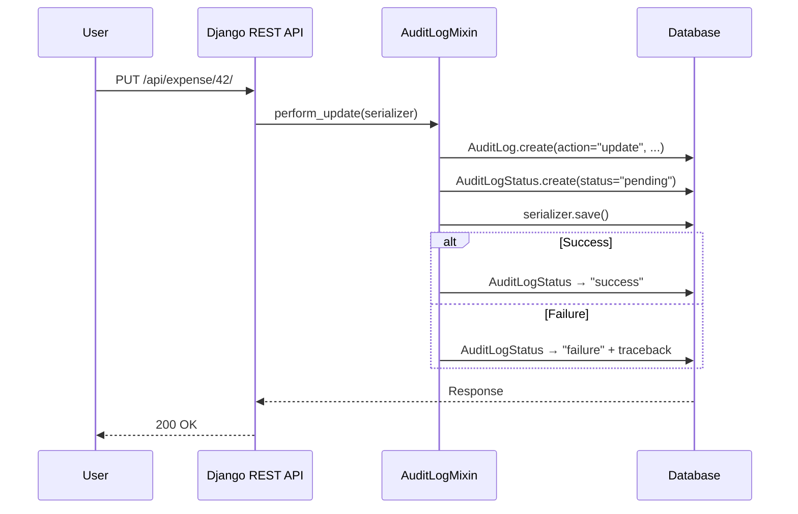

Every API operation in Lex App — create, update, delete — is automatically recorded in an `AuditLog` table. This happens transparently via `AuditLogMixin`, which hooks into the [Django REST Framework](https://www.django-rest-framework.org/) view layer. You don't need to configure or enable anything — audit logging is always active.

## What Gets Recorded

Every time a user creates, updates, or deletes a record through the API, an `AuditLog` entry is created with:

| Field | Description |
|---|---|
| `date` | Timestamp of the operation |
| `author` | The user who performed the action |
| `resource` | The model name (e.g., `expense`, `team`) |
| `action` | `create`, `update`, `delete`, or `action` for a [[access-and-dashboards/actions\|model action]] (3.0) |
| `payload` | The full serialized data at the time of the operation |
| `content_type` + `object_id` | A [generic relation](https://docs.djangoproject.com/en/stable/ref/contrib/contenttypes/) linking back to the affected record |
| `object_ref` | The record's [[access-and-dashboards/custom-api#Public identifiers\|public identifier]] (the value of its `lex_lookup_field`, e.g. a uuid) for models addressed by one; empty otherwise (3.0) |

## Keep personal data out of the log (3.0)

The payload is a copy of what was written, and the author is a name or an e-mail address. If your erasure rules do not reach Lex App's tables, store less:

```python title="lex_config.py"
AUDIT_PAYLOAD = "fields"                 # "full" (default) | "fields" | "none"
AUDIT_ACTOR = "myproject.audit.actor"    # (user) -> str | None
```

```python title="myproject/audit.py"
def actor(user):
    return f"user:{user.pk}"
```

| `AUDIT_PAYLOAD` | Stored payload |
|---|---|
| `"full"` | the payload as sent and saved — the behaviour before 3.0 |
| `"fields"` | the keys only: every value becomes `null`, nested objects keep their keys (`{"iban": null, "address": {"city": null}}`) |
| `"none"` | `{}` |

The rule covers every entry Lex App writes: creates, updates and deletes through the API, bulk changes, record actions, initial data and calculation runs. It does not touch the record's [[history-and-audit/history|history]] tables, which keep their values.

`AUDIT_ACTOR`'s answer is the `author` of every entry and the `created_by` / `edited_by` of every record written in a request — `"user:42"` instead of a name. An empty answer leaves them empty. Unset, Lex App records the user's name, username or e-mail address as before. An unknown `AUDIT_PAYLOAD` or a dotted path that cannot be imported stops the server at startup.

## How It Works



The key insight: the audit log is created **before** the actual operation, with a `pending` status. For normal synchronous requests, the status is updated to `success` right away when the operation finishes. For calculations accepted with HTTP `202`, the status stays `pending` until the background calculation completes, then moves to `success` or `failure`. If an operation fails immediately, the status becomes `failure` and the error traceback is stored. This means even failed operations are recorded — critical for security auditing.

## Audit Log vs. Bitemporal History

These two systems serve different but complementary purposes:

| Aspect | Audit Logs | [[history-and-audit/bitemporal history\|Bitemporal History]] |
|---|---|---|
| **What it tracks** | Who did what, when | What the data looked like over time |
| **Granularity** | Operation-level (create/update/delete) | Field-level (every value change) |
| **Scope** | API operations only | All changes (API, hooks, calculations) |
| **Time dimensions** | One (system time) | Two (valid time + system time) |
| **Primary use** | Security auditing, compliance | Time-travel queries, corrections |
| **Failure tracking** | Yes (pending/success/failure) | No (only successful changes) |

Together, they provide a complete audit trail: bitemporal history tells you *what changed*, audit logs tell you *who requested the change and whether it succeeded*.

## Bulk Operations

Bulk updates and deletes are also tracked via `BulkAuditLogMixin`. Each individual record in a bulk operation gets its own audit log entry — so a bulk update of 100 records creates 100 audit log entries.

## Resilience

The audit system includes built-in resilience:

- **Deadlock retries** — database operations are automatically retried on transient errors (deadlocks, serialization failures)
- **ContentType cache healing** — if Django's ContentType cache goes stale (e.g., after a migration), the system detects and auto-corrects it
- **Error preservation** — failed operations store the full traceback for debugging

> [!note]
> Audit logs are effectively read-only. They are designed to be an immutable record of operations — only administrators should modify or delete them.

## In the Frontend

Audit logs aren't just a database table — they're surfaced directly in the interface:

- **[[using-the-app/record-detail/audit log tab|Audit Log Tab]]** — every record detail page includes an Audit Log tab showing all operations that affected that specific record
- **[[using-the-app/record-detail/timeline tab|Timeline Tab]]** — the audit feed view at the bottom of the timeline integrates audit events with the visual change history

See [[using-the-app/record-detail/index|Record Detail]] for the full user-facing documentation.
