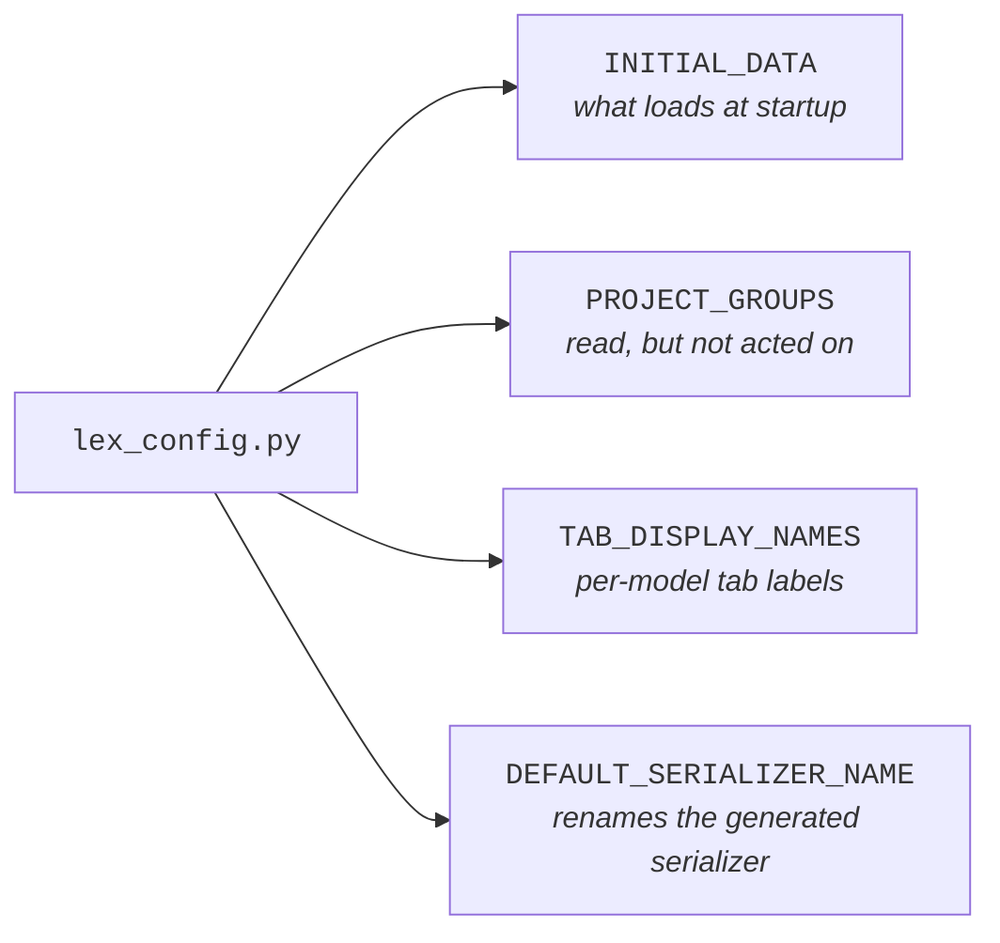

`lex_config.py` lives at your project root and holds project-wide settings the framework reads at boot. It's a plain Python module — the framework executes it at startup (and again whenever it reloads the configuration) and pulls the keys it cares about. Keep it to constants and dotted paths: an import of your own code at the top runs before the app is ready. Most projects only set two or three of these.

> [!note]
> This page is a one-stop index. The individual feature pages linked from each section are the place to go for examples and edge cases.

## Keys at a glance




| Key                       | Purpose                                                                              | Documented in                                                                  |
| ------------------------- | ------------------------------------------------------------------------------------ | ------------------------------------------------------------------------------ |
| `INITIAL_DATA`            | Path to the JSON file the framework loads on **server start** to seed your database  | [[model-your-data/initial data]]                                        |
| `PROJECT_GROUPS`          | A list of group names the framework reads but does not act on — see [below](#project_groups) | [[start-here/tutorial/Part 4 — Validation & Permissions]], [[access-and-dashboards/permissions]] |
| `TAB_DISPLAY_NAMES`       | Friendly labels for the tabs in the record-detail view                               | [[using-the-app/record-detail/index]]                                              |
| `DEFAULT_SERIALIZER_NAME` | Name of the serializer the framework picks when no explicit one is requested         | [[model-your-data/serializers]]                                         |

### Extension keys (3.0)

These keys let a project extend Lex App without overriding Django settings. Every one is optional; unset, Lex App behaves as before. Dotted paths are imported after the app has loaded, so they may point at your own code. Lex App checks them all at startup: a `lex_config.py` that raises, a dotted path that cannot be imported, an unknown `GENERIC_API` mode, `AUDIT_PAYLOAD` or `PERMISSION_SOURCE`, a malformed `REQUEST_SCOPE`, a misspelt `lex_api_exposed` operation or an `API_URLCONF` that does not exist stops the server with an error naming the key — never a silent fallback to the defaults.

| Key | Purpose | Documented in |
|---|---|---|
| `API_URLCONF` | Module with `urlpatterns` for your own endpoints | [[access-and-dashboards/custom-api]] |
| `API_PREFIX` | Where they are mounted. Default `"api/project/"` | [[access-and-dashboards/custom-api]] |
| `PUBLIC_PATHS` | Paths below `API_PREFIX` that answer without sign-in | [[access-and-dashboards/custom-api]] |
| `AUTHENTICATION_CLASSES` | DRF authentication classes tried before Lex App's own | [[access-and-dashboards/custom-api#Your own authentication and middleware]] |
| `MIDDLEWARE_EXTRA` | Middleware per slot: `{"first": [...], "after_auth": [...], "last": [...]}` | [[access-and-dashboards/custom-api#Your own authentication and middleware]] |
| `EXCEPTION_HANDLER` | Your own DRF exception handler, replacing Lex App's | [[access-and-dashboards/custom-api#Errors and database rules]] |
| `DB_ERROR_MAPPER` | Function turning a database error into a `LexActionError` | [[access-and-dashboards/custom-api#Errors and database rules]] |
| `GENERIC_API` | Who may use the generic `api/*` endpoints: `"all"` (default), `"records"` (the operations models expose with `lex_api_exposed`), `"superuser"`, `"off"` | [[access-and-dashboards/generic-api]] |
| `SCHEMA` | OpenAPI schema of your endpoints: `title`, `version`, `include`, `public` | [[access-and-dashboards/custom-api#OpenAPI schema]] |
| `DB_CONTEXT` | Function telling the database who is asking, per request, task and thread | [[ship-and-operate/row-level-security]] |
| `API_KEY_HEADERS` | Additional header names that carry a scoped API key | [[access-and-dashboards/api-keys]] |
| `API_KEY_RESOLVER` | Function replacing the scoped API-key lookup | [[access-and-dashboards/api-keys]] |
| `MUTATION_GROUPS` | Function naming the realtime groups an event about a record goes to | [[ship-and-operate/realtime-events]] |
| `USER_GROUPS` | Function naming the realtime groups a user's sockets join | [[ship-and-operate/realtime-events]] |
| `BITEMPORAL_FUNCTION_ROLES` | Database roles that may run the bitemporal applier's `SECURITY DEFINER` functions; set, EXECUTE is revoked from everyone else after each migrate | [[ship-and-operate/row-level-security]] |
| `EXPOSE_AUTO_SERIALIZER` | `False` stops registering the generated serializer under its alias when a model overrides `default` | [[model-your-data/serializers#Who may pick a serializer]] |
| `PERMISSION_SOURCE` | `"database"` lets row-level security decide for every project model instead of the permission hooks; default `"python"` | [[ship-and-operate/database-decides]] |
| `REQUEST_SCOPE` | `{"param": ..., "resolver": "<dotted path>"}` — the query parameter naming the scope a request acts in, and the function resolving it | [[access-and-dashboards/request-scope]] |
| `AUDIT_PAYLOAD` | How much of a payload the audit log stores: `"full"` (default), `"fields"` (keys only), `"none"` | [[history-and-audit/audit logs#Keep personal data out of the log (3.0)]] |
| `AUDIT_ACTOR` | Function `(user) -> str` naming the author of audit entries and the `created_by` / `edited_by` of records | [[history-and-audit/audit logs#Keep personal data out of the log (3.0)]] |

## `INITIAL_DATA`

```python title="lex_config.py"
INITIAL_DATA = "Tests/test_data.json"
```

The path (relative to the project root) of the JSON fixture loaded **on server start** — `lex start`, and only when every model it references is empty. Neither `lex init` nor `lex create_db` touches it; the loader is gated on the app running under uvicorn. Use it to seed reference data — categories, lookup tables, demo records — so a fresh database isn't empty. See [[model-your-data/initial data]] for the file format and the bulk-load behaviour.

## `PROJECT_GROUPS`

```python title="lex_config.py"
PROJECT_GROUPS = ["team_budget", "finance", "hr_manager"]
```

A flat list of group names. The framework reads it, but nothing acts on it:
`lex init` creates no groups from it, in Keycloak or anywhere else, and no
permission check consults it.

The groups your permission methods see in `user_context.groups` are the
signed-in user's **Django** groups. Create them, and put users in them, with
Django — [[start-here/tutorial/Part 4 — Validation & Permissions#Try It Yourself|Part 4 of the tutorial]]
shows how from `lex shell`.

## `TAB_DISPLAY_NAMES`

```python title="lex_config.py"
TAB_DISPLAY_NAMES = {
    "__default__": {"history_tab": "Change history"},
    "expensereport": {"history_tab": "Revisions", "audit_log_tab": "Who touched this"},
}
```

Keyed by **model name** (lowercase), not by tab. Each value is a dict that may
carry `history_tab` and `audit_log_tab` — those two are the only overridable
labels. `"__default__"` applies to every model without an entry of its own.

> [!warning] A flat `{tab: label}` dict is accepted and ignored
> The loader type-checks the outer dict only, so the tab-keyed shape passes
> validation, changes nothing, and reports no error. If your labels are not
> taking effect, this is why.

## `DEFAULT_SERIALIZER_NAME`

```python title="lex_config.py"
DEFAULT_SERIALIZER_NAME = "compact"
```

Not the serializer used for unqualified requests — that is always `"default"`.

This is the **alias** under which the framework re-registers its own
auto-generated serializer when your project overrides `"default"` on a model.
Without it, overriding `"default"` would leave the framework's full-fidelity
serializer unreachable, and the internal endpoints that need it — history
snapshots, foreign-key reference loaders, `model_info` — would get your
override instead.

Two consequences worth knowing: a request with no `?serializer=` still gets the
framework's serializer rather than a project one, and setting this to the name
of a serializer you already define silently disables the alias. See
[[model-your-data/serializers]] for the selection mechanic.

## Where it fits in the project

`lex_config.py` is a file you create at the project root, beside `.env`, `model_structure.yaml`, `migrations/` and your `Upload/` · `Input/` · `Reports/` folders. `lex setup` does not generate it — that command writes `.env`, the IDE run configurations and `migrations/`, and nothing else. See [[start-here/project structure|Project structure]] for the full layout.

