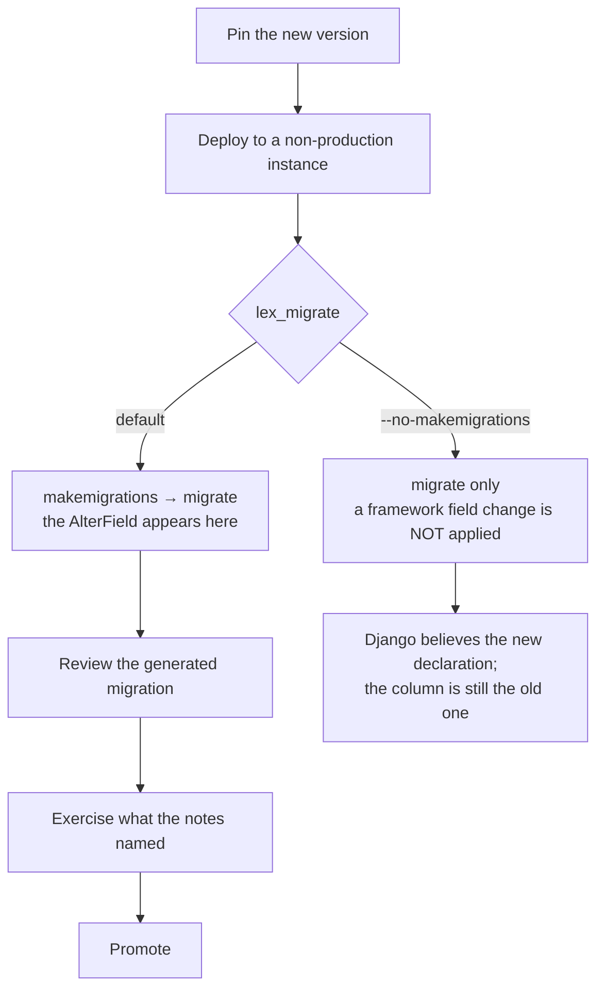

Moving an application to a newer `lex-app`. Most upgrades are a version bump and a deploy. The two that are not — migrations your app has to generate, and the separately-deployed interface — are what this page is about.

## Pin the version

```
lex-app==2.2.0
```

Not `>=`. A framework upgrade can require a migration in your application (see below), so it should happen when you decide, not when a rebuild happens to pick up a newer release.

## Read the release notes first

Every release publishes notes on [GitHub](https://github.com/ExcellenceCloudGmbH/lex-app/releases) and on the changelog. Two things there are worth more than the feature list:

- The **Upgrade note** at the bottom. When there is nothing to do it says so; when there is, that is where it is.
- Whether anything was **withdrawn**. Interface work shipped in 2.1.3 was rolled back in 2.1.4 and returned in 2.2.0 — a feature list read in isolation would have been wrong twice.

## Migrations your application has to generate

A framework change can alter a field your models use, and the migration then belongs to *your* app, not to `lex-app`.

**A worked example, from 2.1.11.** `XLSXField` and `PDFField` had always advertised `max_length=300`, and it had never applied — every plain declaration was silently `varchar(100)`, and an over-length report name was quietly truncated rather than rejected. Fixing it means every application using either field gets one `AlterField` per report column on its next `makemigrations`.

- Deploying with `lex_migrate` (the default) — the migration is generated and applied. Nothing to do.
- Deploying with `--no-makemigrations` — **not safe for this upgrade.** Django believes 300 against an unchanged `varchar(100)` column, and the old silent truncation becomes a `DataError` on the first long filename.

The pattern generalises: if a release note mentions a field's width, type or constraint, either let `lex_migrate` generate the migration or generate it yourself before deploying.

## The interface upgrades separately

The web interface is a built bundle vendored into the package, but a hosted installation serves it from its **own pod** on its own version. So:

> **Upgrading `lex-app` on its own does not give you the new interface.** You can run the newest backend behind an older interface — that is a supported state, and often the desired one.

This matters when a feature spans both halves. The 2.2.0 Streamlit widgets need the interface that renders them; upgrading only the backend gives you the API and none of the controls. When a release says a feature needs the latest interface image, that is what it means.

## Order of operations

1. Read the release notes, including the upgrade note.
2. Pin the new version.
3. Deploy to a non-production instance and let `lex_migrate` run.
4. Check the migration it generated — this is where an unexpected `AlterField` shows up.
5. Exercise the parts of your application that touch whatever the notes mentioned.
6. Promote.

Step 3 is the one with a fork in it. `lex_migrate` generates migrations and
applies them; `--no-makemigrations` applies only what already exists:



The right-hand branch is the one to be careful with, and only on upgrades that
change a field: the schema and Django's idea of it drift apart silently, and the
first over-length value turns what used to be quiet truncation into a
`DataError`.

## Upgrading to 3.0

3.0 changes defaults and removes one model type. Before you upgrade:

- **Security defaults are on.** Error responses no longer carry tracebacks unless `DEBUG` is on, and OIDC sign-in only redirects to your own or a trusted origin. See [[ship-and-operate/security-defaults]] for the full list and the `LEX_LEGACY_SECURITY` opt-out.
- **`Process` is gone.** The `Process` model base class, its `api/process/<name>` endpoint and the frontend's process-flow wizard were removed. A project that still subclasses `Process` fails on import; turn the model into a normal `LexModel` or an `HTMLReport`.
- **Pin `lex-app-frontend~=3.0`** together with `lex-app` 3.0.
- **No settings override needed for your own endpoints.** If your project replaced `ROOT_URLCONF`, `MIDDLEWARE` or `REST_FRAMEWORK` to add endpoints, move that to `lex_config.py` — see [[access-and-dashboards/custom-api]]. The old override keeps working, with two exceptions: remove `drf_spectacular` from your own `INSTALLED_APPS` additions (Lex App installs it now; a duplicate label stops Django), and know that replacing `REST_FRAMEWORK["EXCEPTION_HANDLER"]` also replaces how Lex App renders `LexActionError`.
- **A broken `lex_config.py` stops startup.** It used to print an error and run with the defaults; now an exception in the file, or a dotted path that cannot be imported, stops the server with an error naming the key.
- **Operator endpoints are for superusers.** Changing Django's users through the generic API (400), `POST api/logs` and `api/delete-unused-files` (404) are refused to everyone else, and the calculation log tree shows only logs of records the caller may read. A script that used them as an ordinary user needs a superuser; `LEX_SEC_INTERNAL=false` keeps the old behaviour while you migrate.
- **A refusing `permission_list` hides the list.** A model's own `permission_list` that returns `False` now makes its list endpoint answer 404; it used to hide the model in the navigation only.
- **Errors reach your exception handler.** If you set `EXCEPTION_HANDLER`, it now also receives the generic endpoints' refusals as `LexActionError`, their field errors as `ValidationError` and the errors raised in model code — make sure it renders `LexActionError`. Lex App's own handler keeps every key of the old bodies and adds `code` and `detail`. A `LexActionError` or DRF error raised in `save()` answers with its own status instead of 500, and `run_step` refuses unknown fields on a model with `lex_strict_input`. `LEX_SEC_ERRORS=false` keeps the old answers. See [[access-and-dashboards/custom-api#Errors and database rules]].
- **WebSockets follow `GENERIC_API`.** In every mode except `"all"`, only superusers open a socket under `ws/`; a client of your own that listened there as an ordinary user is now closed with code 4404.
- **A refusal of a row-level security policy answers 404.** A write that a policy rejects (SQLSTATE 42501) used to be a 500 on the generic endpoints; it now answers 404 `NOT_FOUND`, unless your `DB_ERROR_MAPPER` or `EXCEPTION_HANDLER` answers it first. Letting the database decide instead of the permission hooks is opt-in — see [[ship-and-operate/database-decides]]. A project that replaces `MIDDLEWARE` in its own settings and uses that mode keeps `lex.core.permission_source.DatabaseDecidesGuardMiddleware` after the login middleware.
- **Lex App's own tables change.** Its migrations add `AuditLog.object_ref`, the public identifier of the record an entry is about (`audit_logging` 0008), and the audit action `action` (0009). `lex migrate` applies them; nothing to generate in your app.
- **Actions validate first and are audited after they ran.** The input is validated before the permission is asked, so a refused call with invalid input now answers with the validation error. A GET action with `input` validates its query string. The audit entry of an action has `action = "action"` (it was `"update"`) and is written after the run succeeded; a run that raised leaves a `failure` entry. Reports that looked for actions among the `update` entries need the new value. See [[access-and-dashboards/actions]].
- **An unknown path under `api/` is 404.** The frontend's catch-all used to answer every path no route matched with `index.html` and 200, `api/` included, so a removed or misspelt endpoint looked like a success to a client. It now answers 404 (`LEX_SEC_NOT_FOUND=false` restores the old answer). The generic record routes also answer on [[access-and-dashboards/generic-api#Short paths|short paths]] without `calculationId`; the long forms are unchanged.

## Downgrading

Reinstall the older pin and redeploy. The caveat is migrations: a migration your app generated during the upgrade is not reversed by reinstalling the old package. If step 4 produced one, plan the reverse before you need it.

## Related

- [[ship-and-operate/deploying|Deploying]] — `lex_migrate` and startup probes
- [[migrating-from-v1/index|Migrating from V1]] — the different, larger job of moving off `generic_app`
